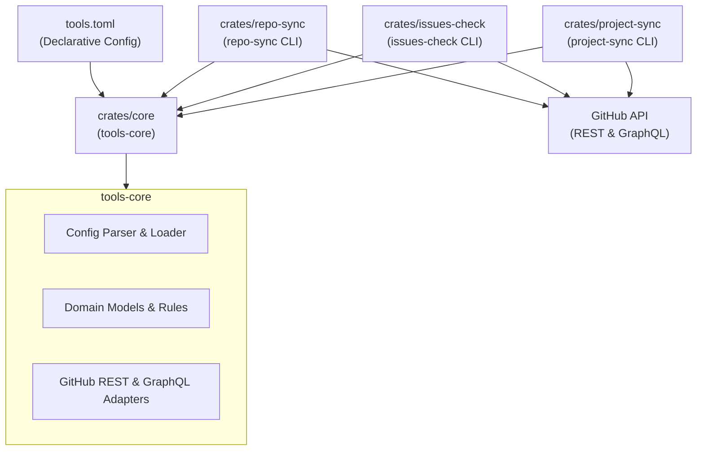

# Tools

[](https://www.apache.org/licenses/LICENSE-2.0)
[](Cargo.toml)

A monorepo for developer tools, declarative repository management utilities, and GitHub workflow automation.

---

## Table of Contents

- [Overview & Purpose](#overview--purpose)
- [Monorepo Architecture & Crates](#monorepo-architecture--crates)
  - [Architecture Diagram](#architecture-diagram)
  - [Crates Overview](#crates-overview)
    - [crates/core (tools-core)](#cratescore-tools-core)
    - [crates/repo-sync (repo-sync)](#cratesrepo-sync-repo-sync)
    - [crates/issues-check (issues-check)](#cratesissues-check-issues-check)
    - [crates/project-sync (project-sync)](#cratesproject-sync-project-sync)
- [Declarative Configuration (tools.toml)](#declarative-configuration-toolstoml)
  - [Repository Settings](#repository-settings)
  - [Labels Schema](#labels-schema)
  - [Milestones Definition](#milestones-definition)
  - [Issue Workflow Rules](#issue-workflow-rules)
- [Developer Quickstart & Tooling](#developer-quickstart--tooling)
  - [Prerequisites](#prerequisites)
  - [Local Environment Setup](#local-environment-setup)
  - [Development Recipes](#development-recipes)
- [Packaging, Installation & GitHub Action](#packaging-installation--github-action)
  - [Composite GitHub Action](#composite-github-action)
  - [Binary Releases & Installation Script](#binary-releases--installation-script)
  - [Nix Flake Packages](#nix-flake-packages)
- [Contributing & Guidelines](#contributing--guidelines)

---

## Overview & Purpose

The `tools` monorepo provides a unified, reliable suite of Rust CLIs and core domain libraries designed to automate and enforce engineering standards across GitHub repositories and organizations.

Key capabilities include:
- **Declarative Repository Synchronization:** Reconcile repository settings (merge options, branch deletion), label taxonomies, and milestone definitions against a single source of truth (`tools.toml`).
- **Issue Workflow Auditing:** Enforce structural integrity on open issues, including strict label taxonomies (`type:*` and `area:*`), mandatory milestone assignments, cyclic dependency detection, and automated migration from legacy labels.
- **GitHub Projects V2 Synchronization:** Map and synchronize project board statuses, dependency blockers, and native sub-issue hierarchies.

---

## Monorepo Architecture & Crates

### Architecture Diagram

The monorepo follows a modular hexagonal/ports-and-adapters architecture where domain logic and external integrations reside in `tools-core`, consumed by focused command-line tools:



### Crates Overview

#### [crates/core](crates/core) (`tools-core`)
Shared foundation library providing domain models, adapters, and configuration parsing.
- **`domain`:** Pure business logic and models representing repository settings, label sets, milestones, issue hierarchies, and validation rules.
- **`config`:** Strongly typed deserialization, defaults, and validation for `tools.toml`.
- **`adapters::github`:** High-performance GitHub REST and GraphQL API clients wrapping `gh` CLI commands and native queries.
- **`application`:** Orchestration logic for auditing, plan generation, and synchronization execution.

#### [crates/repo-sync](crates/repo-sync) (`repo-sync`)
Declarative repository configuration synchronizer. Audits or reconciles GitHub settings, labels, and milestones across single repositories or entire organizations.
- **Drift Detection:** Inspect drift without mutating state:
  ```bash
  cargo run -p repo-sync -- --check
  ```
- **Selective Synchronization:** Target specific configuration surfaces:
  ```bash
  cargo run -p repo-sync -- --settings
  cargo run -p repo-sync -- --labels
  cargo run -p repo-sync -- --milestones
  ```
- **Dry-run Mode:** Preview mutations before execution:
  ```bash
  cargo run -p repo-sync -- --dry-run
  ```

#### [crates/issues-check](crates/issues-check) (`issues-check`)
Workflow integrity and rule auditor for GitHub issues.
- **Workflow Auditing:** Verifies that all open issues comply with milestone assignments, taxonomy rules (`type:*` and `area:*`), and contains no cyclic blocker dependencies:
  ```bash
  cargo run -p issues-check
  ```
- **Label Migration:** Interactively or automatically migrates legacy labels (e.g. `bug`, `enhancement`) to the canonical taxonomy:
  ```bash
  cargo run -p issues-check -- --migrate
  cargo run -p issues-check -- --migrate --apply --default-area area:core
  ```

#### [crates/project-sync](crates/project-sync) (`project-sync`)
CLI tool to automate GitHub Projects V2 board state synchronization.
- Maps issue states, blocked-by relationships, and native sub-issues directly into Projects V2 item fields.
- Supports dry-run inspection:
  ```bash
  cargo run -p project-sync -- --dry-run
  ```

---

## Declarative Configuration (`tools.toml`)

All repository configurations and workflow rules are governed declaratively by [`tools.toml`](tools.toml) in the repository root.

### Repository Settings
Defines target repository identity and merge button constraints:
```toml
[github.repository]
owner = "jaoppb"
name = "tools"

[github.repository.settings]
allow_merge_commit = true
allow_squash_merge = false
allow_rebase_merge = false
delete_branch_on_merge = true
merge_commit_title = "PR_TITLE"
merge_commit_message = "PR_BODY"
```

### Labels Schema
Specifies canonical labels and marks deprecated legacy labels for automated cleanup or migration:
```toml
[github.labels]
deprecated = [
    "bug",
    "enhancement",
    "documentation",
]
items = [
    { name = "type:feat", color = "1d76db", description = "New behaviour or capability" },
    { name = "type:fix", color = "d73a4a", description = "Something is broken" },
    { name = "type:chore", color = "8b949e", description = "Tooling, CI, housekeeping, dependencies" },
    { name = "type:docs", color = "0075ca", description = "Documentation, guides, specifications" },
    { name = "area:core", color = "2ea44f", description = "crates/core: domain models, github client, config" },
    { name = "area:tooling", color = "2ea44f", description = "Flake, Nix, Just, CI, Cargo workspace" },
]
```

### Milestones Definition
Manages release milestones and supports automated renames:
```toml
[github.milestones]
renames = { "v0" = "v0.1.0", "v1" = "v0.2.0" }
items = [
    { title = "v0.1.0", description = "Bootstrap: issue workflow, repository setup, and tooling extraction", state = "open" },
    { title = "v0.2.0", description = "Initial release: stable CLI distribution and packaging", state = "open" },
]
```

### Issue Workflow Rules
Enforces issue invariants during `just issues-check`:
```toml
[github.issues.rules]
cycle = true       # Prohibit cyclic dependency chains
labels = true      # Require exactly one type:* label and >=1 area:* label
milestone = true   # Require every open issue to be assigned a milestone
release = true     # Enforce milestone format conventions
```

---

## Developer Quickstart & Tooling

### Prerequisites

- **Rust**: Rust toolchain supporting edition 2024.
- **[Just](https://github.com/casey/just)**: Command runner for workspace tasks.
- **[Lefthook](https://github.com/evilmartians/lefthook)**: Fast, multi-language Git hooks manager.
- **[GitHub CLI (`gh`)](https://cli.github.com/)**: Authenticated CLI used by adapters to communicate with GitHub.
- *(Optional)* **[Nix](https://nixos.org/)**: A reproducible developer environment is provided via [`flake.nix`](flake.nix) (`nix develop`).

### Local Environment Setup

1. Clone the repository and enter the workspace:
   ```bash
   git clone https://github.com/jaoppb/tools.git
   cd tools
   ```
2. Initialize developer tooling and Git hooks:
   ```bash
   just setup
   ```
   This configures Lefthook pre-commit (formatting and clippy lints) and pre-push hooks (workspace tests and issue checks).

### Development Recipes

Workspace recipes are managed with `just`:

| Recipe | Description | Invocation |
|--------|-------------|------------|
| **Validation & Checks** | | |
| `just check` | Runs formatting checks, workspace type-check, Clippy lints, and unit tests | `just check` |
| `just arch-check` | Validates architecture boundary rules via `arch-lint` | `just arch-check` |
| `just issues-check` | Audits open GitHub issues against workflow rules in `tools.toml` | `just issues-check` |
| `just repo-check` | Verifies GitHub repository settings, labels, and milestones against `tools.toml` | `just repo-check` |
| **Repository Synchronization** | | |
| `just repo-sync` | Reconciles repository settings, labels, and milestones to match `tools.toml` | `just repo-sync` |
| `just settings-sync` | Synchronizes repository merge settings only | `just settings-sync` |
| `just labels-sync` | Synchronizes repository labels only | `just labels-sync` |
| `just milestones-sync`| Synchronizes repository milestones only | `just milestones-sync` |
| `just repo-bootstrap` | Reconciles repository configuration (alias for `repo-sync`) | `just repo-bootstrap` |
| `just org-sync` | Synchronizes configuration across an organization | `just org-sync org="my-org"` |
| **Migration & Releases** | | |
| `just issues-migrate` | Audits or applies legacy label migrations to canonical taxonomy | `just issues-migrate apply=true default_area=area:core` |
| `just bump-version` | Bumps workspace version, updates `Cargo.lock`, tags, and commits | `just bump-version patch` |

---

## Packaging, Installation & GitHub Action

Pre-compiled binary releases, composite GitHub Actions, and Nix packages enable direct consumption in external repositories and CI pipelines without Rust toolchain setup or compilation overhead.

### Composite GitHub Action

To enforce workflow integrity in another repository's GitHub Actions workflow, use the official composite action `jaoppb/tools`:

```yaml
name: Verify Compliance
on: [push, pull_request]

jobs:
  audit:
    runs-on: ubuntu-latest
    permissions:
      contents: read
      issues: read
      pull-requests: read
    steps:
      - name: Checkout repository
        uses: actions/checkout@v4

      - name: Run Tools Compliance Checks
        uses: jaoppb/tools@v0.2.0
        with:
          version: 'latest'
          check-issues: 'true'
          check-repo: 'true'
          github-token: ${{ secrets.GITHUB_TOKEN }}
```

Alternatively, omit `check-*` inputs to install `issues-check`, `repo-sync`, and `project-sync` onto `$GITHUB_PATH` for customized command execution:

```yaml
      - name: Setup Tools CLI
        uses: jaoppb/tools@v0.2.0

      - name: Run Audit
        run: issues-check
        env:
          GH_TOKEN: ${{ secrets.GITHUB_TOKEN }}
```

### Binary Releases & Installation Script

Pre-compiled binaries for Linux (`x86_64`, `aarch64`), macOS (`x86_64`, `apple-silicon`), and Windows (`x86_64`) are published with SHA256 checksums on [GitHub Releases](https://github.com/jaoppb/tools/releases).

Install directly via curl:

```bash
curl -sSL https://raw.githubusercontent.com/jaoppb/tools/main/scripts/install-tools.sh | bash
```

Or install a specific version and toolset:

```bash
TOOLS_VERSION=v0.2.0 TOOLS_LIST="issues-check,repo-sync" ./scripts/install-tools.sh
```

### Nix Flake Packages

Each tool is exposed as a packaged flake output in [`flake.nix`](flake.nix):

```bash
# Run directly without local installation
nix run github:jaoppb/tools#issues-check
nix run github:jaoppb/tools#repo-sync -- --check
nix run github:jaoppb/tools#project-sync

# Enter development shell with all utilities
nix develop github:jaoppb/tools
```

---

## Contributing & Guidelines

For detailed contribution instructions, branch naming conventions, commit formats, pull request standards, and multi-repo onboarding guides, please refer to:

- [CONTRIBUTING.md](CONTRIBUTING.md) — Contributor onboarding, branch/commit naming, PR policy, and setup.
- [AGENTS.md](AGENTS.md) — Canonical rules for human and agent workflows in this repository.
- [docs/multi-repo-onboarding.md](docs/multi-repo-onboarding.md) — Multi-repository and organization-wide setup guide.
